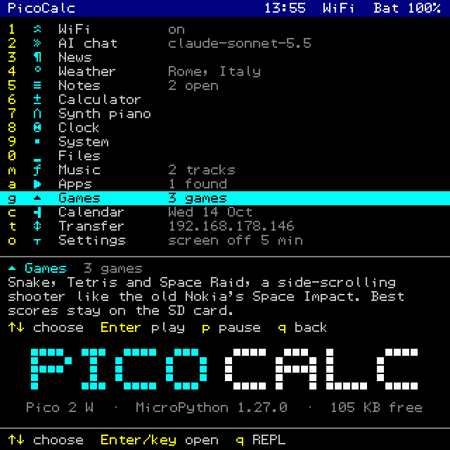
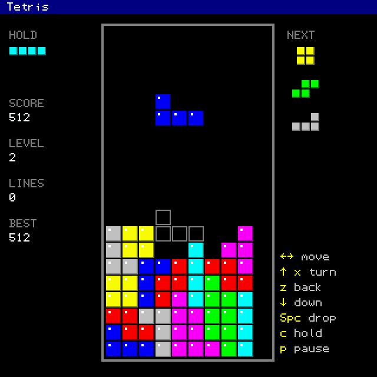
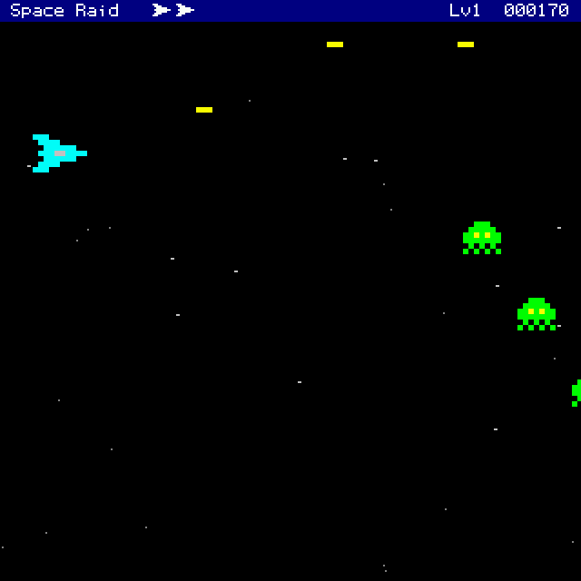
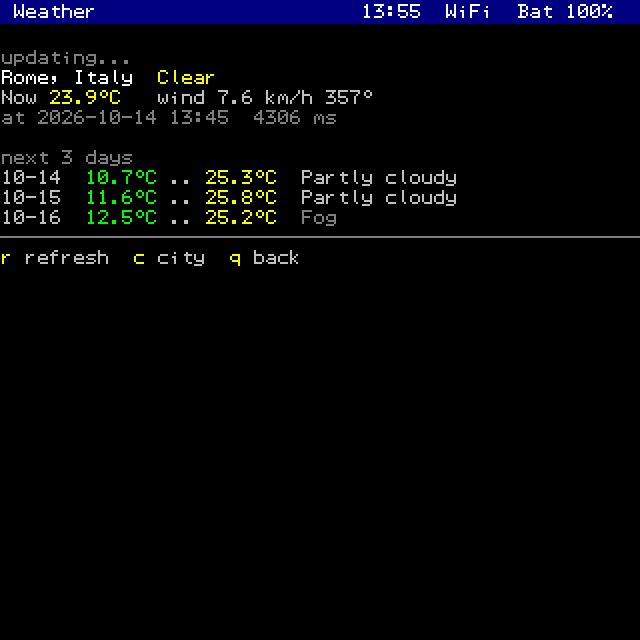

# PicoCalc Toolkit

Wi-Fi + AI + RSS/Miniflux + Clock + Calendar + Notes + Weather + Scientific Calculator + Synthesizer + Music + Files + Wi-Fi file transfer + Apps + Games (Snake, Tetris, Space Raid) + Settings toolkit for the PicoCalc with a Pico 2W, built to be used standalone with the device's own keyboard and screen.

- a launcher menu that opens at power-on (2.4 s, Wi-Fi joins behind it):
  one key per app, `q` to the REPL
- power care: the screen dims and then goes off when idle (music keeps
  playing), the power button switches the screen off, Settings switches the
  PicoCalc off; brightness and keyboard light are kept
- files from a computer's browser to the SD card over Wi-Fi (~270 KB/s)
- a file manager (view, edit with the firmware's editor, run, delete) and
  an Apps list that runs any `.py` you drop in `/sd/apps`
- single-key navigation (no Enter) in menus, viewers and pagers; arrows work
- on the official PicoCalc firmware the toolkit uses the whole 53x40 screen
  and shows accented text correctly (see "Screen" below)
- every module still works from the REPL with short aliases

<p>




</p>

## Quick install
For a Pico 2W in the PicoCalc, with ClockworkPi's MicroPython firmware.

1. Flash `picocalc-micropython-pico2w-*.uf2` from the
   [latest release](../../releases/latest): hold BOOTSEL while plugging in
   the USB cable (or `machine.bootloader()` at the REPL), then copy the file
   to the RP2350 drive. It is ClockworkPi's official firmware with the
   flash-write hang fixed (see "Firmware" below); the files on the Pico stay,
   and the official UF2 goes back on the same way. You can skip this step,
   but on the official firmware a flash write can hang the PicoCalc, copying
   the toolkit included.
2. Unzip `picocalc-toolkit-*.zip` from the same release and copy the files
   in its folder to the Pico's root with the PicoCalc switched on: Thonny's
   Files panel, or `mpremote resume cp *.mpy *.py :` inside the folder.
3. Switch the PicoCalc off and on: the launcher opens. `1`, then `c` joins
   a Wi-Fi network.

From the sources instead: "First-time setup" below, or `tools/deploy.sh`.

## Files
- `default_style.py` → opens the launcher at power-on on the official firmware (see "Launcher")
- `go.py` → `import go` opens the launcher
- `main.py` → opens the launcher at boot where the firmware has no frozen `main.py`
- `menu.py` → launcher: one key per app
- `gfx.py` → draws straight on the screen: the launcher, and a screen console for what apps print
- `gfx_native.py` → native-code (viper) helpers for that console
- `files.py` → file manager for flash and the SD card
- `apps.py` → runs the `.py` files in `/sd/apps` (or `/apps` on flash)
- `games.py` → the Games list, best scores on the SD card, the keyboard read as a game pad
- `snake.py` → Snake
- `tetris.py` → Tetris
- `space.py` → Space Raid, a side-scrolling shooter after the Nokia's Space Impact
- `pico_utils.py` → shared display/keys/IO utilities (used by other modules)
- `wifi_manager.py` → connect logic + interactive setup
- `openrouter_ai.py` → OpenRouter API client + compact chat output
- `rss_news.py` → RSS reader with preview-first output + manual feed management
- `sys_status.py` → RAM, flash, uptime, IP, CPU diagnostics
- `clock_ntp.py` → NTP sync, local time, timer, countdown
- `notes.py` → persistent notes/todo with viewer
- `weather.py` → current weather + forecast via Open-Meteo (free, no API key)
- `scientific_calc.py` → scientific calculator with trig, log, conversions, history
- `music.py` → WAV player on the speakers and headphone jack (PWM + DMA)
- `synthesizer.py` → tone/note/sequence synthesizer with piano interactive mode
- `cal.py` → month calendar, ISO weeks, Italian holidays
- `transfer.py` → Wi-Fi file transfer between a browser and the SD card
- `settings.py` → lights, dimming and screen-off delays, Wi-Fi at start, switching off
- `pico_net.py` → the toolkit's HTTP client (TLS checked where a key goes)

Firmware: the toolkit runs on ClockworkPi's MicroPython for the PicoCalc. On
that firmware a write to the Pico's flash (saving notes or settings) can hang
the device, because the screen refresh runs from the same flash. `tools/build_firmware.sh`
rebuilds the same firmware with that fixed (see CLAUDE.md, Build and deploy):
flash it with `machine.bootloader()` and a copy of the UF2 to the RP2350 drive;
the files on the device stay. Each release carries the UF2 built this way and
tested on a PicoCalc.

Deploy with `tools/deploy.sh` (needs `mpremote` and `mpy-cross`: `brew install
micropython`): it compiles the modules to `.mpy` for the firmware's bytecode
(they load 5-11x faster than `.py`: the launcher is up 2.4 s after power-on
instead of 4.2), keeps `main.py`, `go.py` and `default_style.py` as source,
copies with the panel refresh stopped and restarts the device;
`tools/deploy.sh --py` sends plain sources. `tests/` stays on the computer.
`sd/apps/hello.py` is a sample app: copy it to `/sd/apps/` on the card.

Data files created automatically:
- `/wifi_credentials.json` → saved Wi-Fi networks
- `/openrouter_config.json` → AI key, model, system prompt
- `/rss_feeds.json` → RSS feed list + display settings
- `/clock_config.json` → UTC offset
- `/notes_data.json` → saved notes/todo items
- `/weather_config.json` → location (lat, lon, name)
- `/miniflux_config.json` → Miniflux URL + API key (optional)
- `/sd/games.json` → the games' best scores and switches (on flash, `/games.json`, when there is no card; an old `/snake.json` is read once)
- `/settings.json` → brightness, keyboard light, dim/screen-off delays, Wi-Fi at start (Settings)

## Launcher (standalone use)
It opens by itself when the PicoCalc is switched on; from the REPL,
`import go` opens it again:

```
1 WiFi   2 AI chat   3 News   4 Weather   5 Notes   6 Calculator
7 Synth piano   8 Clock   9 System   0 Files   m Music   a Apps   g Games
c Calendar   t Transfer   o Settings
```

- an app's key opens it; ↑/↓ and Enter work too
- under the list a panel says what the highlighted app does and its keys
- each app has its own one-key sub-menu (keys shown in yellow); `q`/Esc goes back
- the title bar shows time, Wi-Fi and battery; some apps show a hint
  (Wi-Fi state, AI model, weather city, open notes)
- at start it asks the radio to join a saved network (the last one used
  first, no scan) and is drawn at once; the title bar says WiFi when the
  link is up, and the clock is set from NTP behind it (Settings can turn
  this off)
- `q` leaves to the REPL; `import go` reopens it
- `mpremote` or Thonny connecting over USB also leaves to the REPL, so
  they get it at once (the screen says `REPL (USB host)`)
- it draws straight into the screen's memory (`gfx.py`) instead of printing
  through the terminal: the whole screen in ~40 ms instead of ~550, a move
  in ~10 ms instead of ~100

### How it opens at power-on
The official ClockworkPi firmware freezes its own `boot.py` and `main.py`
inside the firmware, and MicroPython runs a frozen `main.py` before any
`main.py` on flash, so the toolkit's `main.py` never runs there. But the
frozen `boot.py` imports `default_style` (the editor's colours), and a file
on flash wins over a frozen module of the same name. The toolkit's
`default_style.py` passes the colours through and, on a cold start (the
first 5 seconds after power-on or reset) with `go.py` installed, puts
`import go` + Enter in the keyboard buffer: the REPL runs it as if typed.
Soft resets (Ctrl+D, `mpremote`) leave the REPL alone.

To go back to the stock REPL at power-on, delete the hook:
`mpremote resume rm :default_style.py`.

On a firmware without a frozen `main.py` the toolkit's `main.py` should
open the launcher instead (that follows from MicroPython's `pyexec.c`;
not tried).

## Screen
On the official PicoCalc firmware `pico_utils` reads the terminal size
(53x40) and uses 52 columns and 25-line pages, sized for the screen
console below; elsewhere it falls back to 32x8.

The firmware's terminal draws each character as a CP437 glyph, and its
`write()` reports characters instead of bytes: the first accented
character printed (an ANSA headline, an Italian AI answer) made MicroPython
detach the screen and keyboard until reset. `pico_utils` replaces that
writer with one that reports bytes and maps accented letters to their
CP437 glyphs (letters CP437 lacks, like `È`, become plain ASCII). This
covers everything printed, the REPL included.

Two more firmware bugs it works around once loaded (the launcher loads it
at power-on):
- scrolling the terminal could write past the end of the screen's memory,
  into the SD card driver's buffer: SD errors (`EIO`, "timeout waiting for
  response", then "no SD card" until the PicoCalc is switched off and on).
  The toolkit keeps the last screen row out of the scroll region, so the
  REPL scrolls 39 rows instead of 40.
- Ctrl+U, the firmware's screenshot key, crashed whatever was reading keys
  (at the REPL it detached the screen). It now saves the screen to
  `/sd/screen_<number>.bmp`.

The terminal draws about 9,500 characters a second (its driver hands them
to C one at a time from a Python loop). While the launcher runs, nothing
goes through it: the launcher draws into the screen's memory with C calls
(`gfx.py`), and what the apps print is drawn the same way by gfx's screen
console, a run of text at a time. Measured: a screen of 20 accented
headlines in 66 ms instead of 307, a streamed AI answer 65 ms instead of
164. The apps look like the launcher: a 12-pixel title bar, 10-pixel
rows, highlight bars across the screen, separators as lines, solid bars.
From the REPL (`q` in the launcher) the firmware terminal is back.

One more firmware bug, in the screen's own font: three glyphs have seven
rows instead of eight, so everything from code 0x8E on was drawn one to
three rows up (`ò`, `ù`, `·`, the launcher's icons). gfx draws those from
a realigned copy.

## Look
Colours (the terminal's 16-colour palette), a title bar with time, Wi-Fi
and battery, bars for RAM/flash/battery, a big block-digit clock and a
progress bar for the countdown. `s.colors()` (System → `c`) shows the
palette. Everything on screen is drawn rather than printed while the
launcher runs: highlight bars, thin separator lines, solid bars, the
PICOCALC logo in square blocks and the clock's digits as solid blocks.

## Keys
Menus, viewers and pagers react to single keys, no Enter:
- viewers (`ai.view()`, `n.view()`, `t.view()`, `mp.browse()`):
  `n`/→/space next, `p`/← prev, `d`/↑/Enter detail, `q`/↓/Esc quit,
  digits + Enter jump to an item
- pagers ("-- more --"): any key continues, `q`/Esc stops
- long-running loops (countdown, melodies, playback) stop with `q`/Esc:
  Ctrl+C from the PicoCalc keyboard only acts while the program reads input
- free text (chat questions, notes, calculator) still uses a normal input
  line ending with Enter; prompts that need it say "Enter"
- System → `k` (or `s.keys()`) shows the raw bytes and name of each key and
  logs them to `/keylog.txt`: use it if a key does nothing

## PicoCalc commands
- `import wifi_manager as w`
- `w.acs()` → saved-only connect
- `w.ac()` → interactive setup: pick a network with one key, the password
  is masked with `*`
- `w.st()` → print current Wi-Fi status
- `w.saved()` → list saved networks
- `w.forget(2)` / `w.forget('MyWifi')` → remove a saved network
- after connecting, the clock is set from NTP if it was not set yet
- `w.ver()` → print module version
- `w.help()` / `w.h()` → short command list

## OpenRouter AI setup
Order of use:
- Connect Wi-Fi first, then use AI commands.

1. Make sure Wi-Fi is connected (`w.st()`).
2. Import AI module:
	- `import openrouter_ai as ai`
3. Save your key:
	- `ai.set_api_key('sk-or-v1-...')`
4. (Optional) choose a model:
	- `ai.set_model('openai/gpt-4o-mini')`
5. Ask a question:
	- `ai.ask('Explain DNS in simple words')`

Default model: `anthropic/claude-sonnet-5.5` on OpenRouter ($2 / $10 per
million input / output tokens: about 0.3 cents per short answer).
Replies stream in as they are generated, word-wrapped to the screen.
A question already sent can't be cancelled from the keyboard.
Prompt and response size limits reduce memory pressure.

### AI commands
- `import openrouter_ai as ai`
- `ai.ask('your question')` → one request
- `ai.chat()` → prompt loop (`Q>`; empty line exits)
- `ai.chat_view()` → prompt loop + open viewer after each answer
- `ai.responses()` → list cached recent responses
- `ai.resp_clear()` → clear cached responses to free RAM
- `ai.view(1)` / `ai.v(1)` → continuous response browser
- `ai.set_api_key('sk-or-v1-...')` → save API key
- `ai.set_model('openai/gpt-4o-mini')` → set default model
- `ai.set_system_prompt('...')` → save custom response style/rules
- `ai.clear_system_prompt()` → remove custom system prompt
- `ai.presets()` → list quick style presets
- `ai.preset('brief')` / `ai.p('teacher')` → apply preset quickly
- `ai.mem_on()` / `ai.mem_off()` → enable/disable short rolling memory
- `ai.mem_status()` → show memory state and usage
- `ai.mem_clear()` → clear memory buffer
- `ai.show_config()` → show model, key presence, endpoint, streaming
- `ai.set_endpoint('http://192.168.1.20:8080/v1/chat/completions')` → any
  OpenAI-compatible server (llama-server, LM Studio); no key needed there,
  and the OpenRouter key is only ever sent to OpenRouter;
  `ai.set_endpoint(url, 'key')` if that server wants its own key (kept with
  the URL, dropped when it changes); `ai.set_endpoint()` → back to OpenRouter
- `ai.set_stream(False)` → wait for whole replies (for servers that don't stream)
- `ai.ver()` / `ai.help()` / `ai.h()`

System prompt behavior:
- default system prompt is optimized for concise, small-screen output
- custom system prompt is saved in `openrouter_config.json`
- used on every request before memory/user messages

Preset names:
- `brief` → very short bullet-style replies
- `teacher` → step-by-step simple explanations
- `code` → practical coding-focused responses

Memory behavior (Pico-safe):
- default: enabled
- keeps only last 6 messages (rolling window)
- uses little RAM while giving short multi-turn context

## RSS news setup
Recommended UX on PicoCalc:
- preview-first (faster, less memory, readable on the small screen)
- open one item in detail only when needed (`read(...)`)
- browse multiple items in sequence with viewer mode (`view(...)`)

Order of use:
- Connect Wi-Fi first, then use RSS commands.

1. Import RSS module:
	- `import rss_news as n`
2. Show current feed list:
	- `n.feeds()`
3. Read latest previews:
	- `n.latest()`
4. Open one item in detail:
	- `n.read(1)`

Manual feed management from PicoCalc:
- `n.add_feed('BBC', 'https://feeds.bbci.co.uk/news/world/rss.xml')`
- `n.add_feed_prompt()`
- `n.rm_feed(2)` or `n.rm_feed('BBC')`
- `n.reset_feeds()`

RSS config safety/performance notes:
- feed config is sanitized automatically at load (invalid/duplicate entries removed)
- max configured feeds: 12
- HTTP client is initialized once per `n.latest()` run (less overhead across many feeds)
- read-only commands (`n.feeds()`, `n.latest()`, `n.view()`, `n.setup()`) avoid config writes

Display/throughput tuning:
- `n.set_preview(110)` → preview chars per item (range: 48..320)
- `n.set_items_per_feed(2)` → items per feed fetch (range: 1..4)

Default feeds in this version:
- BBC World
- ANSA
- Al Jazeera

The old CNN default no longer works (its HTTPS endpoint refuses the
connection, the HTTP one has not been updated since 2023). Saved configs
keep it: run `n.rm_feed('CNN')` or `n.reset_feeds()`.

Each feed download stops after 26 KB, enough for the first items.

RSS command list:
- `import rss_news as n`
- `n.latest()` / `n.l()` → fetch and show previews from all feeds
- `n.latest(1)` / `n.latest('CNN')` → fetch one feed only
- `n.view(1)` / `n.v(1)` → continuous news browser
- `n.read(1)` / `n.r(1)` → show selected cached item details
- `n.feeds()` / `n.f()` → list configured feeds
- `n.add_feed(name, url)` / `n.add_feed_prompt()`
- `n.rm_feed(index_or_name)` / `n.reset_feeds()`
- `n.set_preview(chars)` / `n.set_items_per_feed(count)`
- `n.setup()` / `n.ver()` / `n.help()` / `n.h()`

### Miniflux
Read the unread entries of your own Miniflux in the same viewer:
- `n.mf_setup('https://feed.example.com', 'API-KEY')` → save server + key
- `n.mf()` → fetch the 3 newest unread entries, then `n.view(1)`
- `n.mf_done()` → mark the fetched entries as read on the server

Create a dedicated API key for the PicoCalc (Miniflux: Settings → API Keys):
it is stored in plain text on flash, and MicroPython's `requests` does not
verify TLS certificates. Revoke it if the device is lost. A 401 stops at
once without retrying. Long articles are fetched one at a time.

## System status
- `import sys_status as s`
- `s.info()` / `s.a()` → full system overview (RAM, flash, uptime, IP, CPU)
- sizes are shown in compact B/KB/MB form
- `s.ram()` → free/used RAM after gc.collect
- `s.flash()` / `s.df()` → flash storage usage
- `s.uptime()` → time since boot
- `s.ip()` → current IP, gateway, DNS
- `s.bat()` → battery percent and charging state (PicoCalc keyboard MCU)
- `s.info()` → dashboard with bars (RAM, flash, battery), uptime, IP, CPU
- `s.keys()` → key test, logs to `/keylog.txt`
- `s.colors()` → the 16 colours of the palette
- `s.freq()` → CPU frequency
- `s.ls()` / `s.ls('/lib')` → list files with sizes
- `s.gc_run()` → force garbage collect and show freed bytes
- `s.ver()` / `s.help()` / `s.h()`

## Clock + NTP
Order of use: connect Wi-Fi first, then sync time.

1. `import clock_ntp as c`
2. `c.sync()` → sync from NTP (requires Wi-Fi)
3. `c.now()` / `c.n()` → show local time
4. `c.date()` / `c.d()` → show day + date + time
5. `c.utc()` → show UTC time
6. `c.epoch()` → raw epoch seconds

After power-on the clock reads 2021-01-01 until `c.sync()`; `c.now()` and
`c.date()` say so.

Timezone:
- `c.set_utc_offset(1); c.set_dst(True)` → Italy/Central Europe, summer time
  switches by itself (EU rule: last Sunday of March and October, 01:00 UTC)
- `c.set_utc_offset(1)` → CET (Central European Time)
- `c.set_utc_offset(2)` → CEST (summer) or EET
- `c.set_utc_offset(-5)` → US Eastern
- Saved to `clock_config.json`

Timer/Stopwatch:
- `c.timer_start()` / `c.ts()` → start
- `c.timer_stop()` / `c.tp()` → stop and show elapsed
- `c.timer_check()` / `c.tc()` → check without stopping
- `c.timer_toggle()` → start or stop

Countdown:
- `c.countdown(120)` / `c.cd(120)` → wait 120s with progress updates, then
  print TIME! and beep three times
- `q`/Esc cancels

Live clock:
- `c.live()` → big block-digit clock updating every second; any key returns

In the launcher, Clock → `z` sets the zone with one key: `1` Italy/CET
(UTC+1 with EU summer time), `2` UK, `3` UTC, `4` any other offset.

Full command list:
- `c.ver()` / `c.help()` / `c.h()`

## Notes / Todo
Persistent notes stored in `notes_data.json` on flash. Max 50 notes.
Timestamps use local time (the `c.set_utc_offset()` value) and stay blank
until the clock is set with `c.sync()`. In the viewer `x` toggles done.

- `import notes as t`
- `t.add('Buy milk')` → quick add (title auto-generated)
- `t.add('details here', title='Shopping')` → with explicit title
- `t.add_lines()` → multi-line input (empty line = done)
- `t.add_prompt()` → interactive title + note prompt
- `t.ls()` / `t.l()` → list all notes with [x]/[ ] status
- `t.show(1)` / `t.s(1)` → show full note
- `t.view(1)` / `t.v(1)` → continuous viewer (n/p/d/q/arrows)
- `t.edit(1, 'new text')` → replace note body
- `t.done(1)` → mark as done [x]
- `t.undone(1)` → unmark
- `t.rm(1)` → delete note
- `t.clear_done()` → remove all done notes at once
- `t.count()` → total / done / open summary
- `t.ver()` / `t.help()` / `t.h()`

## Weather
Uses Open-Meteo API (free, no API key required). Requires Wi-Fi.

Default location: Rome (41.9, 12.5). Change with:
- `m.set_city('Paris')` / `m.sc('Paris')` → geocode city name
- `m.set_location(48.85, 2.35, 'Paris')`
- `m.set_location(40.71, -74.01, 'New York')`
- Saved to `weather_config.json`

Commands:
- `import weather as m`
- `m.report()` / `m.r()` → current weather and the 3-day forecast from one
  request (the launcher's Weather screen)
- `m.now()` / `m.w()` → current temperature, wind, conditions
- `m.forecast()` / `m.fc()` → 3-day forecast (min/max temp + conditions)
- `m.forecast(7)` / `m.fc(7)` → up to 7 days
- `m.set_city('Rome')` / `m.sc('Rome')` → lookup city and save coords
- `m.set_location(lat, lon, 'name')` → save precise coords
- `m.show_location()` → show current lat/lon/name
- `m.ver()` / `m.help()` / `m.h()`

Weather output fits the PicoCalc screen without wrapping.

## Scientific Calculator
Pure math module with no network or hardware dependencies. Works offline.

- `import scientific_calc as sc`
- `sc.sin(1.57)` → sine (radians by default)
- `sc.cos(0)` / `sc.tan(1)` → cosine / tangent
- `sc.asin(1)` / `sc.acos(0)` / `sc.atan(1)` → inverse trig
- `sc.sqrt(16)` → square root
- `sc.log(10)` → natural log (ln)
- `sc.log10(100)` / `sc.log2(8)` → base-10 / base-2 log
- `sc.exp(1)` → e^x
- `sc.power(2, 10)` → 2^10
- `sc.factorial(5)` → 5! = 120
- `sc.abs_val(-5)` / `sc.ceil(1.2)` / `sc.floor(1.8)`
- `sc.hypot(3, 4)` → hypotenuse = 5
- `sc.pi()` / `sc.e()` → constants

Angle mode:
- `sc.deg()` → switch to degrees
- `sc.rad()` → switch to radians (default)
- `sc.mode()` → show current mode

Conversions:
- `sc.d2r(180)` / `sc.r2d(3.14)` → degrees ↔ radians
- `sc.c2f(0)` / `sc.f2c(32)` → Celsius ↔ Fahrenheit
- `sc.km2mi(10)` / `sc.mi2km(6)` → km ↔ miles

Variables and history:
- `sc.store('x', 42)` → save variable
- `sc.store('y')` → save last result as y
- `sc.recall('x')` → retrieve variable
- `sc.variables()` → list all stored variables
- `sc.clear_vars()` → clear all variables
- `sc.last()` → show last result
- `sc.history()` → show calculation history
- `sc.clear_history()` → clear history

Interactive mode:
- `sc.calc()` → expression prompt (uses `ans` for last result, stored variables available)
- Type math expressions directly: `sqrt(2) + pi`
- Start with `+`, `*`, `/` or `%` to continue from the last result
  (`*2` means `ans*2`); a leading `-` is still a negative number
- Results too long for the screen switch to scientific notation
- Type `q` or empty line to exit

Full command list:
- `sc.ver()` / `sc.help()` / `sc.h()`

## Music
`m` in the launcher, or `import music; music.player()`: plays WAV files from
`/sd/music` (and the card's root) on the speakers or the headphone jack.

- the list shows every `.wav`; Enter plays from there to the end of the list
- Space pauses, `+`/`-` (or ↑/↓) set the volume (0-16), ←/→ previous/next
  track, `q` stops
- `b` keeps it playing **in the background**: back to the launcher, the
  playlist goes on while you use the other apps (the title bar shows ► and
  Music's line the track). It is fed from every key wait, so an app that
  blocks for a while (a network request) pauses it for that long. Open
  Music again for the controls; `q` there stops it, and so does leaving the
  launcher to the REPL
- formats: PCM WAV, 8 or 16-bit, mono or stereo, 4000-48000 Hz.
  **16-bit stereo at 22,050 Hz** is the sweet spot (88 KB/s from the card)

**MP3**: MicroPython on the PicoCalc has no MP3 decoder (PicoMite and
ClockworkPi's MP3Player firmware decode in C, as separate firmwares), so
convert on the computer first:

```
tools/to_wav.sh song.mp3 other.m4a     # -> song.wav, other.wav
```

It uses macOS `afconvert` (or `ffmpeg` elsewhere) and writes 16-bit stereo
22,050 Hz files; copy them to `music/` on the card with Transfer (`t`, over
Wi-Fi) or a card reader (USB serial manages only ~8 KB/s, minutes per song).

How it plays: PWM slice 5 drives GP26 (left) and GP27 (right) with a
146 kHz carrier and 10-bit levels; a PWM slice with no pins ticks at the
sample rate and paces two chained DMA channels that write each sample into
the PWM, while Python refills the idle buffer from the SD card a step at a
time (read at 8 MHz during playback, then the driver's 1.3 MHz again). A
channel chains to the other only once that buffer is full, so if the card
falls behind the sound stops for a moment (the screen counts these "gaps")
instead of replaying old samples, and the end of a track always plays.

Commands:
- `music.player()` / `music.m()` → the track list
- `music.play('/sd/music/song.wav')` / `music.p()` → one file
- `music.volume(12)` → 0-16
- `music.ls()` → list the tracks found
- `music.playing()` → the track playing in the background, `music.background_stop()`

## First-time setup
1. Upload the `.py` files of the repo root to the Pico root (not `tests/`),
   e.g. `mpremote resume cp *.py :` (with the PicoCalc switched on: on USB power
   alone its keyboard controller is off and answers I2C errors).
2. Switch the PicoCalc off and on: the launcher opens (or type `import go`).
   Press `1`, then `c` to pick a Wi-Fi network; the clock is set from NTP
   once connected, and at later starts the launcher joins it by itself.
3. `8` (Clock) → `z`: UTC offset `1` and `y` for EU summer time (Italy).

## Synthesizer
Software tone/note synthesizer. Supports PWM output (built-in PicoCalc speakers) and I2S output (external DAC).

Audio output modes:
- **PWM mode** (default): drives the PicoCalc speakers on GP26 (L) and GP27 (R); produces square waves
- **I2S mode**: uses SCK=GP16, WS=GP17, SD=GP28 (external DAC); produces sine/square/saw/triangle waveforms; enable with `sy.use_pwm(False)`. On the PicoCalc GP16/GP17 are the SD card pins, so I2S breaks `/sd` until reset.

Quick start (PicoCalc built-in speakers):
1. `import synthesizer as sy`
2. `sy.tone(440, 500)` → play 440 Hz for 500 ms
3. `sy.piano()` → interactive keyboard mode

Quick start (external I2S DAC):
1. Connect DAC: SCK→GP16, WS→GP17, SD→GP28
2. `import synthesizer as sy`
3. `sy.use_pwm(False)` → switch to I2S output
4. `sy.piano()` → interactive keyboard mode

Commands:
- `import synthesizer as sy`
- `sy.piano()` → interactive keyboard: each key plays at once (r=redraw, q/Esc=exit)
- `sy.tone(hz, ms)` → play frequency in Hz for ms milliseconds
- `sy.note('C4', ms)` → play note by name (C4, A#5, Db3, -)
- `sy.seq('C D E F G A B')` → play space-separated note sequence (- or r = rest)
- `sy.demo('scale')` → play a demo melody (scale, twinkle, ode, nokia, elise)
- `sy.rtttl('name:d=4,o=5,b=120:8e6,8d6,4c#6')` → play an RTTTL ringtone
- `sy.beep(3)` → short beeps (used by the countdown)
- melodies stop with `q`/Esc
- `sy.wave('sine')` → set waveform: sine, square, saw, triangle (I2S only)
- `sy.octave(4)` → set octave (0..8)
- `sy.volume(70)` → set volume (0..100)
- `sy.bpm(120)` → set tempo
- `sy.duration(200)` → set note duration in ms
- `sy.use_pwm(True)` → use PWM output (built-in speakers, default)
- `sy.use_pwm(False)` → use I2S output (external DAC)
- `sy.set_pwm_pin(26, 27)` → change PWM output pin(s)
- `sy.set_pin(28)` → change I2S SD pin
- `sy.close()` → release audio hardware
- `sy.ver()` / `sy.help()` / `sy.h()`

Piano keyboard layout:
```
  C# D#    F# G# A#
  s  d     g  h  j
[z][x][c][v][b][n][m]
 C  D  E  F  G  A  B
```
Controls: +/- octave, 1-4 waveform, r redraw, q/Esc quit

Troubleshooting:
- No sound from PicoCalc speakers: run `sy.use_pwm(True)` then `sy.tone(440, 300)`
- If wrong pin: run `sy.set_pwm_pin(n)` with the correct pin number(s)
- PWM produces square waves only; for other waveforms use I2S mode with external DAC
- `q`/Esc exits piano mode and clears the screen

## File manager
`0` in the launcher, or `import files; files.browse()`. It starts at the
flash root, where `sd/` is the SD card.

- ↑/↓ choose, Enter (or →) opens a folder or shows a text file, ← (or
  Backspace) goes up, `q` back to the launcher
- `e` edits the file in the firmware's editor (pye): Ctrl+S then Enter
  saves, Esc or Ctrl+Q quits. Files over 32 KB are refused: the editor
  keeps the whole file in RAM
- `r` runs a `.py` file the way the Apps list does
- `d` deletes a file or an empty folder (asks `y`; a file in the flash
  root, where the toolkit, its settings and the power-on hook live, asks
  for the word `yes`)
- `n` makes a new file (opens the editor), `m` a new folder
- the viewer shows the first 32 KB, a page per key (Space/↓ next, ↑ back);
  binary files only show their size

It never asks the SD card for its free space: on a 32 GB card the first
`os.statvfs('/sd')` scans the whole FAT and takes over a minute.

Commands:
- `files.browse('/sd')` / `files.b()` → browser
- `files.view('/notes_data.json')` / `files.v()` → viewer
- `files.edit('/sd/apps/new.py')` / `files.e()` → editor

## Apps from the SD card
`a` in the launcher lists every `.py` file in `/sd/apps` (and `/apps` on
flash); Enter or the row's number runs it as `__main__`. When it ends (or
on `sys.exit()`, Ctrl+C or an error, whose traceback stays on screen) a
key brings the list back, and the modules it imported are unloaded.

A header in the first five lines names the app:

```python
# picocalc-app: Name | what it does
```

The three-field form `Name | Category | what it does` works too. Without a
header the file name is used. An app can import the toolkit
(`pico_utils`, `synthesizer`...) and files next to it in its folder.
`sd/apps/hello.py` in this repo is a starting point.

Commands:
- `apps.launcher()` / `apps.l()` → the list
- `apps.run_app('/sd/apps/hello.py')` / `apps.r()` → run one file
- `apps.ls()` → print what was found

## Games
`g` in the launcher, or `import games; games.show()`: Snake, Tetris and
Space Raid, each also on its own (`import tetris; tetris.play()`). In every
game `p`, Esc or `q` pause (then Enter plays on, `q` quits), `m` turns the
sound off and on (it stays off while music plays in the background), and
the score box after a game takes Enter for another one, `q` to go back.
The best scores live in `/sd/games.json`: a game never writes the Pico's
flash while it runs (with the panel refresh on, a flash write can hang the
PicoCalc; without a card the file is written to flash once, when you leave
a game). While a game runs it reads the keyboard controller itself, so it
knows which keys are held: the ship flies and Tetris pieces slide while you
hold an arrow.

- **Snake**: arrows or WASD steer; each food speeds it up.
- **Tetris**: left/right move (held, they slide), up or `x` turns, `z`
  turns back, down drops faster, Space drops, `c` holds a piece for later.
  A level every 10 lines; the next three pieces and a ghost of where the
  piece lands are shown.
- **Space Raid**, after the Nokia 3310's Space Impact: arrows fly the
  ship, Space (or `x`, `z`) fires while held, `c` fires the special weapon
  the pods give (`M` missiles, `B` a beam across the screen; `+` is a life).
  Waves of six kinds of ships, a boss at the end of each level, then the
  levels again, tougher. `n` switches the screen to the 3310's two greens.

## Calendar
`c` in the launcher, or `import cal; cal.show()`. A month at a time,
Monday first, with ISO week numbers; today is highlighted, Sundays and the
Italian public holidays are red (Easter and Easter Monday computed), and
the month's holidays are listed under the grid. ←/→ month, ↑/↓ year, `t`
today, `q` back. `cal.easter(2027)`, `cal.holidays(2027)` and
`cal.iso_week(2027, 1, 1)` work from the REPL.

## Transfer (files over Wi-Fi)
`t` in the launcher, or `import transfer; transfer.serve()`. While its
screen is up the PicoCalc serves the SD card on the local network: open
the address it shows (`http://<its IP>/`) in a browser on the same Wi-Fi,
type the PIN shown on the PicoCalc, pick a folder, then download, upload
(several files, with a progress bar) or delete. `q` closes it, also in
the middle of a transfer. Measured:
~270 KB/s up and ~200 KB/s down (USB serial manages ~8 KB/s), so a
26 MB WAV goes over in about a minute and a half.

From a terminal:
```
curl -T song.wav -H "X-PIN: 123456" "http://192.168.1.50/api/put?dir=music&name=song.wav"
curl -H "X-PIN: 123456" "http://192.168.1.50/api/ls?dir=music"
curl -o song.wav "http://192.168.1.50/api/get?dir=music&name=song.wav&pin=123456"
curl -X DELETE -H "X-PIN: 123456" "http://192.168.1.50/api/rm?dir=music&name=song.wav"
```

It is the only thing in the toolkit that listens on the network, so it is
kept small: it runs only while its screen is open; a new 6-digit PIN each
time, needed by every request but the page itself, and 10 wrong ones
close it; the SD card only (the card's root and the folders directly in
it), plain file names; uploads up to 64 MB land in a `.part` file that is
renamed only once complete and removed if anything goes wrong; a client
has 10 seconds for a request and may not stall a transfer for longer.

## Settings, power and the screen
`o` in the launcher, or `import settings; settings.show()`. ↑/↓ choose,
←/→ (or Enter) change, `q` back. Everything is kept in `/settings.json`.

- **Screen brightness** (1-15) and **keyboard light** (off, 1-7): the
  keyboard controller forgets them when the PicoCalc is switched off, so
  the launcher sets them again at start. Alt+, and Alt+. (screen) and
  Alt+Space (keys) still change them for the moment.
- **Dim after** (default 1 min) and **screen off after** (default 5 min)
  without a key. Screen off means a black picture, the backlight at the
  controller's minimum and the keyboard light off; what was on screen
  comes back with the next key, which does nothing else. Music keeps
  playing with the screen off.
- **Power button**, a short press: the screen goes off at once (if the
  keyboard controller's firmware sends that key: check with System → `k`).
- **Wi-Fi off in standby**: after a minute of screen off in a key wait,
  Wi-Fi goes off too and joins again in the background on wake.
- **Wi-Fi at start**: the launcher joins a saved network by itself.
- **Switch off**: the keyboard controller switches the PicoCalc off after
  6 seconds. On USB power the Pico itself stays on: it waits for the
  PicoCalc to be switched on again and then restarts.

## Security
- Requests that carry a key (OpenRouter, a Miniflux token, a custom AI
  endpoint's key) to a server on the internet check its TLS certificate
  against four roots built into `pico_net.py` (Google Trust Services R1/R4,
  ISRG X1/X2: OpenRouter and Let's Encrypt sites). That costs 1.4-3.7 s per
  request and needs the clock set (the launcher sets it from NTP; the
  check tries once more itself). A server signed by another authority is
  refused with `certificate check failed` (until its root is added to
  `pico_net.py`): never sent the key anyway. A key is never sent over
  plain http to a server on the internet. Feeds and weather carry no key
  and are not checked (faster).
- Redirects keep the timeout, stop after three and never carry a key to
  another server.
- Text from outside (feed titles, AI replies, place names, Wi-Fi names, file
  names) loses its control characters before it reaches the screen: an
  escape sequence could otherwise drive the firmware terminal past the
  end of the screen memory and corrupt the SD card.
- Keys and passwords live in JSON files on flash, readable by anyone with
  the device and a USB cable (as anything on it).

## Startup files on PicoCalc
`boot.py` starts the screen, keyboard, SD card (`/sd`) and speakers. The
official ClockworkPi firmware (2025-10-30 build) keeps it frozen inside the
firmware; older driver builds keep it on flash. If yours is on flash, do
**not** delete it: without it the device only has a REPL over USB.

## Troubleshooting
- If disconnected after startup: run `w.acs()`, then `w.st()`.
- If still disconnected: run `w.ac()` and re-enter password.
- Reset credentials: delete `/wifi_credentials.json` and run setup again.
- If version mismatch after upload: reset or reconnect REPL, then `w.ver()`.
- If AI says `certificate check failed`: the server's certificate is not signed by a root in `pico_net.py` (the provider changed CA): add its root there.
- If AI says `clock not set: can't check the certificate`: Wi-Fi is up but NTP failed: Clock → `s`, then try again.
- If AI says `No API key.`: run `ai.set_api_key('sk-or-v1-...')`.
- If OpenRouter returns HTTP error: verify key/model and internet access.
- If a network app says `Missing urequests.`: `pico_net.py`, the toolkit's HTTP client, is missing on the Pico: copy it again.
- If RSS returns no items: try `n.latest(1)` to test one source only.
- If feed fails repeatedly: remove and re-add URL (`n.rm_feed(...)`, `n.add_feed(...)`).
- If NTP sync fails: check Wi-Fi connection, retry `c.sync()`.
- If ntptime missing: run `import mip; mip.install('ntptime')`.
- If weather shows wrong location: run `m.set_city('Rome')` or `m.set_location(lat, lon, 'name')`.
- If synthesizer makes no sound: run `sy.use_pwm(True)` then `sy.tone(440, 300)` (built-in speakers).
- If the speakers stay silent: try `sy.set_pwm_pin(28, 27)` (some official ClockworkPi sources put the left channel on GP28).
- If screen and keyboard stop responding after Thonny or `mpremote` connected (or with the PicoCalc switched off): the firmware's terminal detached itself. `import go` from USB, or a reset, brings it back; once the toolkit is loaded it no longer happens.
- If the launcher does not open at power-on: check that `default_style.py` and `go.py` are on the Pico (`import os; os.listdir()`). It only opens on a cold start, not after Ctrl+D or an `mpremote` soft reset.
- After `mpremote`/Thonny took over, the PicoCalc is at the REPL: `import go`, or switch it off and on.

## Known limitations
- **Uptime**: `s.uptime()` resets after ~12-25 days (MicroPython `ticks_ms` overflow). Mitigated with `ticks_diff` but still wraps on very long runs.
- **WAV format**: Only standard PCM WAV files are fully supported. Files with extra metadata chunks (LIST, INFO) are now handled, but exotic formats may still fail.
- **Cancelling**: Ctrl+C from the PicoCalc keyboard only acts while the program reads input; long loops poll for `q`/Esc instead, and a request already sent (AI, news, weather) runs until it answers or times out.
- **MP3 playback**: no MP3 decoder in MicroPython here; `tools/to_wav.sh` converts on the computer.
- **Volume**: Software-scaled on 16-bit WAV. Very low volumes may reduce audio quality.
- **RAM**: Large RSS feeds or long AI responses may cause memory pressure. Use `s.gc_run()` to free RAM.

## Quick reference (all aliases)
```
import menu                # menu.run()
import files               # files.b() files.v(path) files.e(path)
import apps                # apps.l() apps.r(path) apps.ls()
import games               # games.s() games.play('tetris')
import snake               # snake.p()
import tetris              # tetris.p()
import space               # space.p()
import wifi_manager as w   # w.ac() w.acs() w.st() w.saved()
import openrouter_ai as ai # ai.ask() ai.chat() ai.v()
import rss_news as n       # n.l() n.r(1) n.v(1) n.f() n.mf()
import sys_status as s     # s.a() s.ram() s.df() s.ls() s.bat()
import clock_ntp as c      # c.n() c.d() c.ts() c.tp() c.live()
import notes as t          # t.l() t.s(1) t.v(1)
import weather as m        # m.r() m.w() m.fc() m.sc('Rome')
import scientific_calc as sc # sc.sin() sc.sqrt() sc.calc()
import music               # music.m() music.p(path) music.volume(n)
import synthesizer as sy   # sy.piano() sy.tone() sy.use_pwm()
import cal                 # cal.s() cal.easter(y) cal.holidays(y)
import transfer            # transfer.s()
import settings            # settings.s() settings.switch_off()
import pico_utils as pu    # pu.backlight(n) pu.keyboard_light(n) pu.screen_off()
```

## Current version
Check on the device with `<module>.ver()`: each app module carries its own
version, `YYYY-MM-DD.N`, bumped whenever that module changes.
